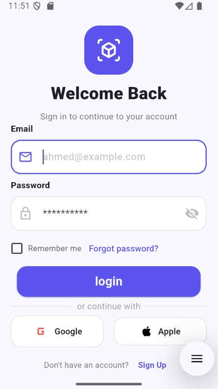
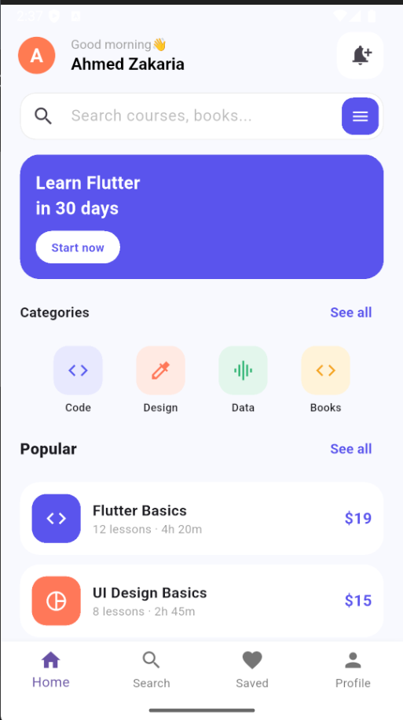

# Flutter UI Practice — Auth & E-Learning Screens

A clean and modern **Flutter UI** practice repository featuring two standalone screens: a **User Authentication (Login) Screen** and an **E-Learning Home Dashboard**. 

> **Note:** Both screens are built as independent UI tasks/components and are not connected via navigation.

---

## 📱 Screenshots

| Login Screen | E-Learning Home Screen |
| :---: | :---: |
|  |  |

---

## ✨ UI Highlights

### 1. Login Screen
* Clean header with app branding icon and welcome typography.
* Styled `TextFormField` inputs for **Email** and **Password** with prefix icons and password visibility toggle.
* **Remember Me** checkbox and **Forgot Password** action link.
* Primary CTA button, **Social Login** options (Google & Apple), Sign-Up prompt, and a Floating Action Button (FAB).

### 2. E-Learning Home Screen
* Personalized top header with user avatar, greeting message, and notification badge button.
* Search bar with integrated filter action button.
* Featured promotional banner card (*"Learn Flutter in 30 days"*).
* Categorized quick-access icons (**Code**, **Design**, **Data**, **Books**).
* **Popular Courses** cards displaying course title, lesson count, duration, and pricing.
* Bottom Navigation Bar (**Home**, **Search**, **Saved**, **Profile**).
